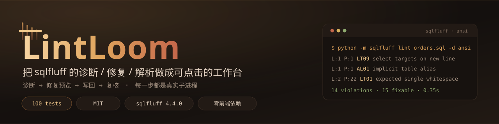
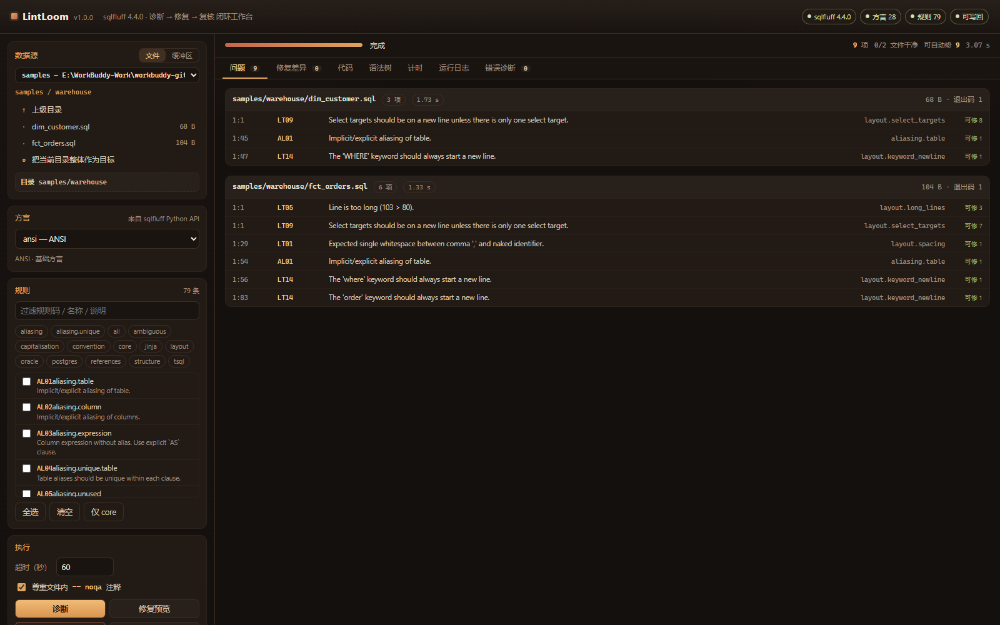
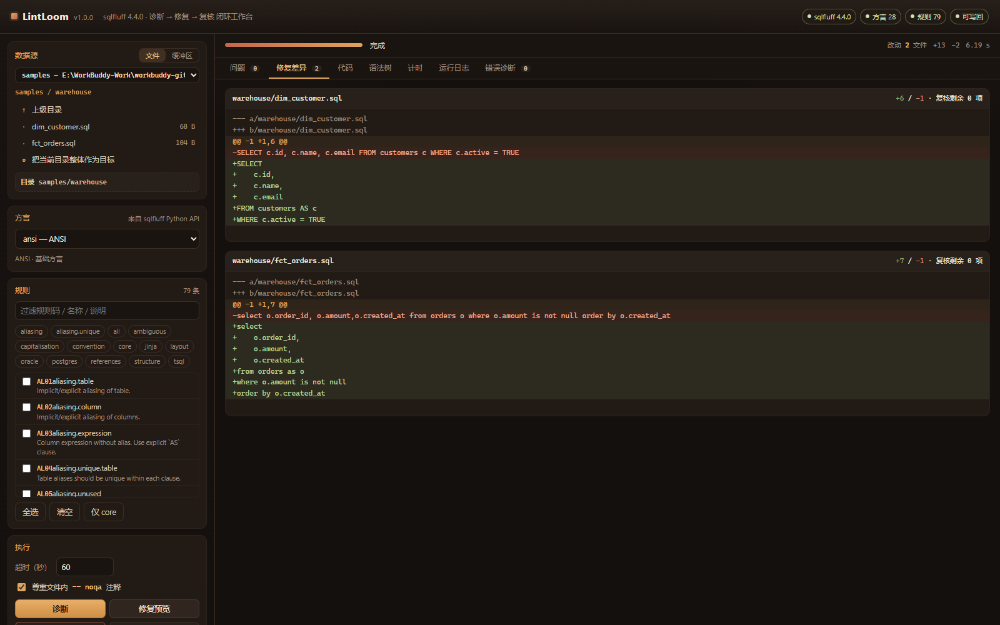
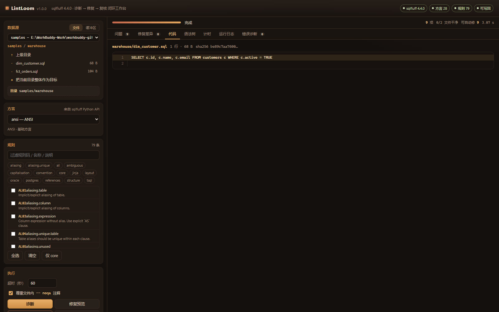
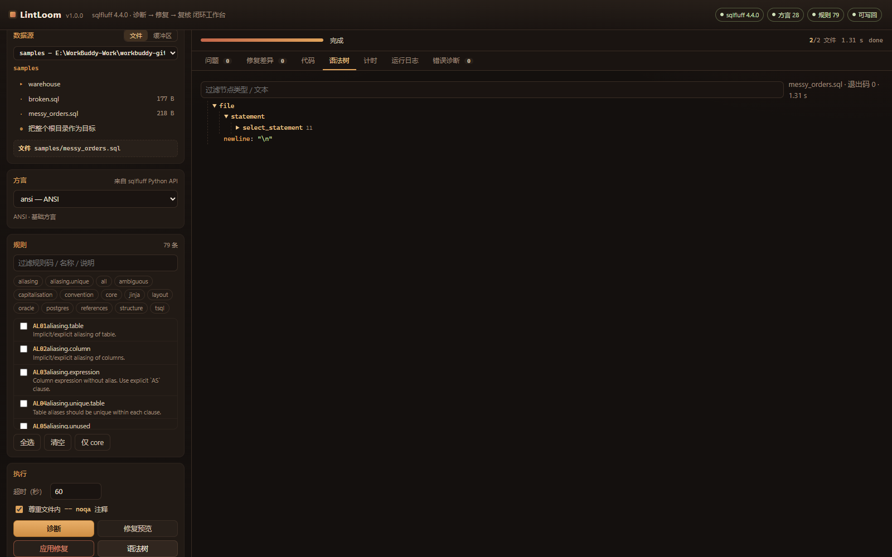
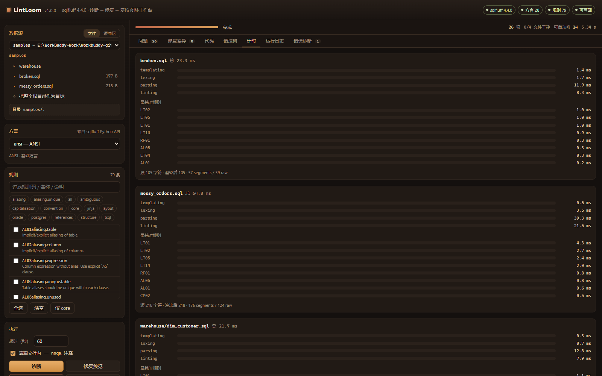
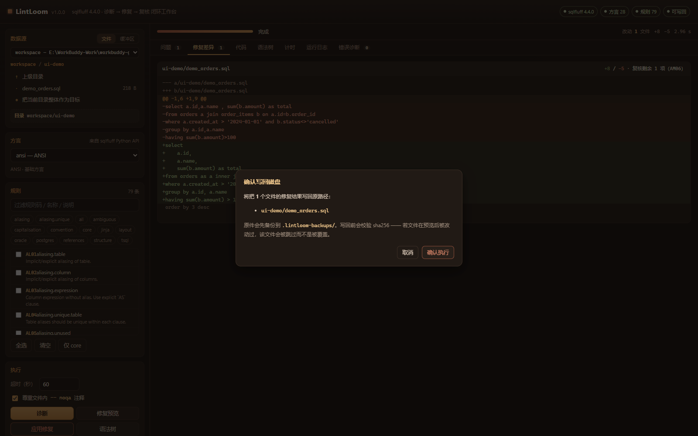
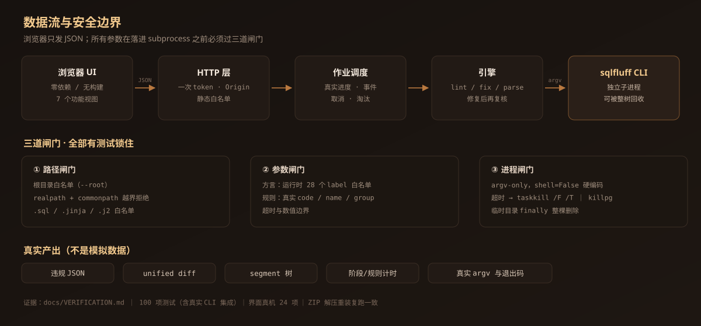

# LintLoom



把 **sqlfluff** 的命令行能力（诊断 / 自动修复 / 语法解析）变成一套可点击、可观察、可复核的可视化工作台。
界面上的每一个动作都真的会启动 `python -m sqlfluff` 子进程，没有任何模拟数据。

- 上游目标：[`sqlfluff/sqlfluff`](https://github.com/sqlfluff/sqlfluff) · MIT · 4.4.0
- 本项目：MIT，Python 3.9+，**运行时零第三方依赖**（除 sqlfluff 自身）
- 形态：本地 Web 应用（stdlib `http.server` + 原生 HTML/CSS/JS，无框架、无构建、离线可用）

---

## 界面

| 诊断：目录级逐文件进度，点任意行跳到代码 | 修复预览：临时副本 + diff + 修复后复核 |
|---|---|
|  |  |

| 代码定位：行号与问题行严格对齐 | 语法树：sqlfluff 解析出的 segment 树 |
|---|---|
|  |  |

| 计时：上游自报阶段与规则耗时 | 写回：二次确认 + sha256 并发保护 |
|---|---|
|  |  |

以上截图由 Playwright 驱动 **Microsoft Edge 内核**真实点击产生（非手工拼图），
并在 `docs/VERIFICATION.md` 中记录了每一步的断言值。

架构与安全边界：



---

## 1. 30 秒上手

```bat
install.cmd      :: 建虚拟环境 + 装 sqlfluff + 环境自检
start.cmd        :: 启动服务并自动打开浏览器（http://127.0.0.1:8731）
test.cmd         :: 跑全部 100 项测试（含真实 CLI 集成测试）
```

手动方式等价于：

```bash
python -m venv .venv
.venv/Scripts/python -m pip install -r requirements.txt
.venv/Scripts/python run.py
```

启动后浏览器会自动打开；如果没打开，复制控制台打印的地址即可。地址里带着一次性访问令牌，
**不要**把地址发给别人，也不要让服务监听 `0.0.0.0`。

启动参数：

| 参数 | 作用 |
|---|---|
| `--port 8731` | 换端口 |
| `--host 127.0.0.1` | 监听地址（默认仅本机） |
| `--python <exe>` | 指定运行 sqlfluff 的解释器（多环境场景） |
| `--root work=D:\sql` | 追加一个可访问根目录（可重复） |
| `--read-only` | 禁止「应用修复」写回磁盘 |
| `--no-browser` | 不自动开浏览器 |
| `--selftest` | 只打印环境自检 JSON 后退出 |

---

## 2. 能做什么

| 面板 | 真实动作 | 后端实际执行的命令 |
|---|---|---|
| 诊断 | 逐文件诊断，进度按文件推进 | `sqlfluff lint <file> -d <dialect> -f json` |
| 修复预览 | 在临时副本上修复，产出 unified diff，并把修复后的内容**再诊断一次** | `sqlfluff fix <tmp> -x _lintloom_fix` → `sqlfluff lint - -f json`（stdin） |
| 应用修复 | 二次确认 → 校验 sha256 → 备份 → 原子写回 → 写回后复核 | 同上 + 文件系统操作 |
| 语法树 | 展示 `file → statement → select_statement …` 的 segment 树 | `sqlfluff parse <file> -f json` |
| 计时 | 阶段耗时（templating/lexing/parsing/linting）+ 最耗时规则 Top 8 | 直接取自 lint JSON 的 `timings` 字段 |
| 缓冲区 | 粘贴 SQL 走 stdin，不落盘 | `sqlfluff lint - -f json` / `sqlfluff fix -` |
| 错误诊断 | 把 stderr 归类成方言/路径/规则/权限/超时/解析失败，并给处置建议 | 解析真实 stderr |

方言清单（28 个）与规则清单（79 条，含分组与旧码别名）在启动时由
`app/catalog_probe.py` 调用 sqlfluff 公开 API（`Linter.rule_tuples()` / `dialect_readout()`）实时获取，
**不写死在代码里**；探针失败时退化为解析 CLI 文本输出（并处理方言名被 80 列截断的续行问题）。

---

## 3. 安全模型

这是本地工具，但它会**创建进程**和**写文件**，所以边界必须显式定义。

### 3.1 命令注入

- 唯一的进程入口是 `app/runner.run(argv)`，`argv` 必须是字符串列表，`shell=False` 硬编码。
  参数原样交给 `CreateProcess`/`execve`，`; & | > $( ) \`` 不会被解释。
- 方言不是自由文本：必须命中运行时从 sqlfluff 取到的 28 个 label 之一，且先过 `^[a-z][a-z0-9_]{0,31}$`。
- 规则引用必须是真实存在的 code / name / group，形态上还要过
  `^[A-Z]{2}[0-9]{2}$` 或 `^[a-z][a-z0-9_]*(\.[a-z0-9_]+){0,4}$`。
- 有测试专门跑注入串（`ansi; rm -rf /`、`$(whoami)`、`LT01 --config=/evil` 等）断言一律 400。

### 3.2 路径

- 只接受「根目录标识 + 相对路径」，根目录由启动参数决定，浏览器无权新增。
- 拒绝：绝对路径、盘符、UNC、`~`、`..`、NUL、控制字符、超长（>512）、
  以空格或点结尾的片段（Windows 会静默去掉，导致校验路径 ≠ 实际路径）。
- `os.path.realpath` 之后再比 `commonpath`，挡住符号链接逃逸；扩展名白名单 `.sql/.jinja/.j2`。
- 这一层有 26 项单元测试，含「不依赖 symlink 权限」的 realpath 闸门测试。

### 3.3 进程与资源

- 每条命令都有超时（默认 60s，上限 300s，可在界面调）；超时后 `taskkill /F /T`（Windows）
  或 `killpg`（POSIX）回收**整个进程树**，有测试用「孙进程」验证不会留下孤儿。
- 管道与句柄在 `finally` 里关闭；stdout/stderr 超过 8MB 截断并打标。
- 修复预览/写回的临时目录在 `finally` 里整棵删除（`shutil.rmtree`）。
- 作业并发上限 2，历史作业最多保留 60 条。

### 3.4 Web 面

- 只绑 `127.0.0.1`；每个进程生成一次性 token 注入首页，所有 `/api/*` 必须带 `X-LintLoom-Token`
  （同机其它网页无法 CSRF 驱动本工具）。
- `Origin` 必须为空或与 `Host` 一致；POST 只收 `application/json`，请求体上限 1MB。
- 静态资源是白名单映射，不做目录拼接，天然没有静态目录穿越。
- 前端所有用户数据一律走 `textContent` / 转义函数，不用 `innerHTML` 拼接不可信内容。

### 3.5 写盘

- 默认允许；`--read-only` 可关。
- 必须先跑「修复预览」，前端把预览时的 sha256 一起回传；若文件在此期间被改动，该文件被**跳过**而非覆盖。
- 备份先落盘到 `.lintloom-backups/<时间戳>/<根>/<相对路径>`，再用 `os.replace` 原子替换。

---

## 4. 架构

```
run.py                 启动参数 → Settings → server
app/config.py          常量、根目录、上限、Settings
app/paths.py           信任边界：路径/方言/规则/超时/布尔校验
app/runner.py          唯一进程入口：argv-only、超时、进程树回收、输出截断
app/catalog.py         方言/规则目录（Python API 探针 + CLI 文本兜底）
app/catalog_probe.py   独立子进程里的探针，输出 JSON
app/jobs.py            作业：进度、事件日志、取消、淘汰
app/engine.py          编排：lint / fix_preview / fix_apply / parse / stdin 两种
app/server.py          HTTP 路由、token、Origin、静态白名单
app/web/               index.html + styles.css + app.js（零框架）
tests/                 100 项测试
docs/                  验证记录、限制说明
samples/               自带样例（只读演示）
workspace/             默认可写目录（放你自己的 SQL）
```

数据流：浏览器 → `/api/jobs` → `JobManager.submit` → 工作线程 → `Engine.action_*` →
`runner.run([python, -m, sqlfluff, ...])` → 解析 JSON/文本 → 返回结果；前端 320ms 轮询进度。

---

## 5. 测试

```bash
.venv/Scripts/python -m unittest discover -s tests -v
```

| 文件 | 覆盖 |
|---|---|
| `test_paths.py` | 路径穿越、绝对路径、symlink 逃逸、控制字符、扩展名、方言/规则注入、标量校验（26 项） |
| `test_runner.py` | 无 shell、元字符原样传递、超时、**孙进程回收**、stdin、输出截断、取消（11 项） |
| `test_engine.py` | 真实 lint/fix/parse：结果断言、规则过滤、PRS 检测、预览不改盘、写回+备份、sha 冲突跳过、只读模式（16 项） |
| `test_jobs.py` | 生命周期、失败归类、取消、事件上限、淘汰（9 项） |
| `test_server.py` | 真实 HTTP：token、Origin、静态资源、遍历拦截、端到端作业、预览→写回全链路（23 项） |
| `test_catalog_fallback.py` | CLI 文本兜底解析，含方言名截断续行（7 项） |

测试不 mock 上游：`test_engine.py` / `test_server.py` 会真的跑 sqlfluff。当前：**100 项通过，1 项跳过**
（symlink 用例在无管理员/开发者模式的 Windows 上自动跳过，同一逻辑由 realpath 闸门测试覆盖）。

---

## 6. 故障排查

| 现象 | 原因 | 处置 |
|---|---|---|
| 徽标显示「环境异常」 | 当前解释器没装 sqlfluff | 跑 `install.cmd`，或用 `--python` 指定已有环境 |
| 诊断页提示 `DIALECT` | 方言不在运行时清单里 | 用下拉框选，不要手输 |
| 提示 `RULES`「规则引用被忽略」 | 用了旧版规则码（如 `L001`） | 在右侧规则面板重新勾选；旧码仅作别名存在 |
| 作业状态 `timeout` | 单文件诊断超过设定超时 | 调大超时或缩小目标范围；引擎已回收进程树 |
| 写回时被跳过 | 预览后文件被外部修改（sha 不一致） | 重新跑「修复预览」再写回 |
| 端口被占用 | 8731 已被别的程序使用 | `--port 8801` |

---

## 6.1 仓库内配图

| 文件 | 说明 |
|---|---|
| `docs/assets/banner.svg` | 自绘横幅 |
| `docs/assets/architecture.svg` | 自绘数据流与三道闸门 |
| `docs/screenshots/*.png` | Playwright + Edge 真实点击产生的界面截图（8 张） |

图片全部随仓库分发，不依赖外部图床；验证方式见 `docs/VERIFICATION.md` 第 5 节。

## 7. 已知限制

1. **按文件起进程**：目录诊断时每个文件一次 CLI 调用（约 0.3–0.6s/文件），换来的是真实进度和单文件故障隔离；
   代价是 200 文件上限内总耗时高于「一次调用传整个目录」。上限可用 `Settings.max_files` 调整。
2. **不评估 `.sqlfluffignore`**：目录遍历由本工具自己做（为了逐文件进度），
   因此被 ignore 的文件仍会出现在列表里；如需严格一致，请直接对单文件操作。
3. **模板化方言**：`sqlfluff` 对 Jinja/dbt 模板需要项目侧 `.sqlfluff` 配置；本工具会把 templater 报错
   归到 `TEMPLATE` 诊断，但不会替你生成配置。
4. **只在 Windows 10/11 + Python 3.13 实测**：POSIX 分支（`start_new_session` + `killpg`）代码已实现，
   但未在本机实机验证。
5. **单用户本地工具**：没有多用户鉴权、没有历史持久化，重启即清空。

---

## 8. 来源与许可

上游项目、许可证、核实方式与复用边界见 **[SOURCES.md](SOURCES.md)**；
本项目自身代码为 MIT（见 [LICENSE](LICENSE)）；第三方声明见 [NOTICE](NOTICE)。
